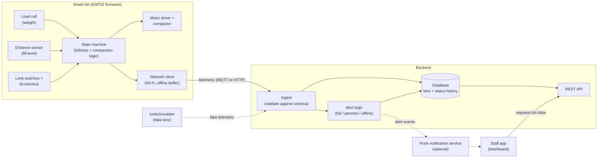
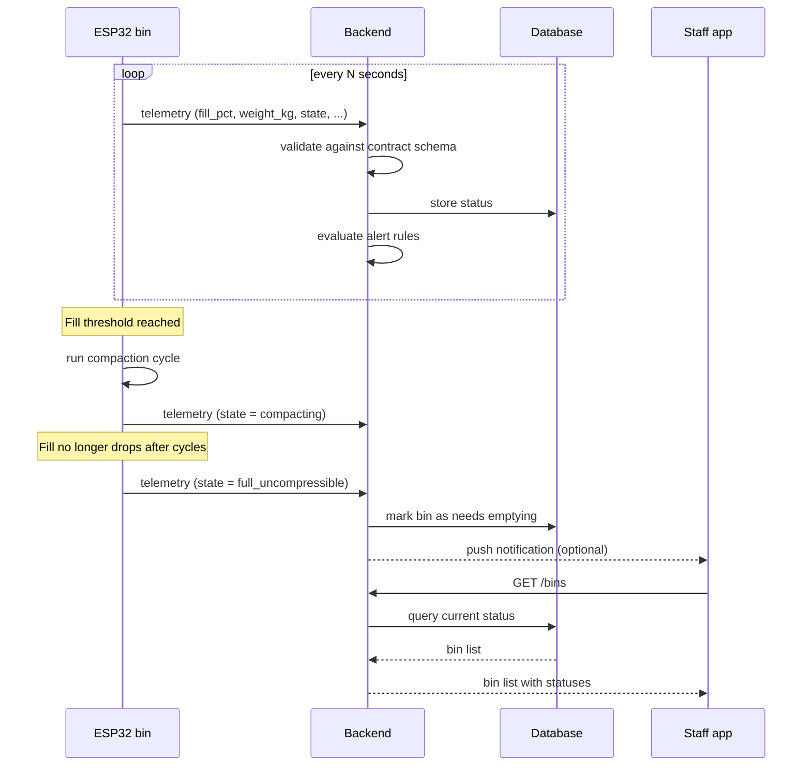
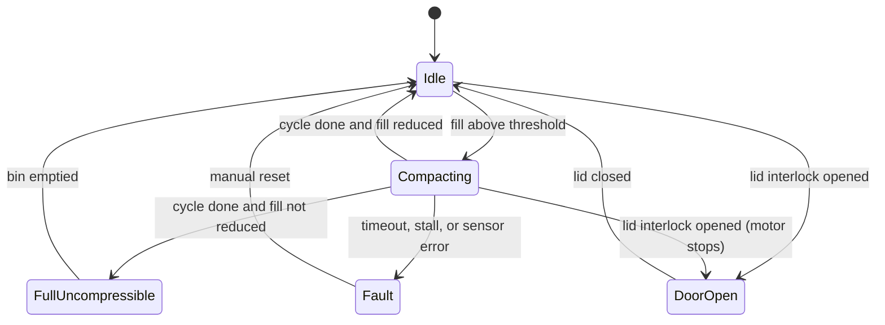

# Architecture

This document describes how the Smart Bin system fits together and who owns each part. The diagrams use [Mermaid](https://mermaid.js.org/), which renders automatically on GitHub.

## 1. System overview

Arrows are labelled with what is sent, and they point from the side that **initiates** the connection to the side that receives it.

**Reading the diagram**

- Solid arrows are the main data path. Dotted arrows are optional or development-only.
- Telemetry flows bin → backend → app. The bin never talks to the app directly.
- Safety logic (motor limits, interlock) lives entirely inside the firmware box. The server is never in the safety path.

## 2. Telemetry and alert flow

If the bin loses Wi-Fi, the firmware buffers readings locally and sends them when the connection returns. The backend marks a bin **offline** if it hasn't reported within an expected window.

## 3. Firmware state machine

The state machine lives in `firmware/bin_firmware/src/logic/` and has no Arduino dependencies, so it can be unit-tested on a laptop.

The state names match the `state` values in the telemetry contract (`idle`, `compacting`, `full_uncompressible`, `fault`, `door_open`).

## 4. Components and ownership

| Component | Location | Responsibility | Owner |
| --- | --- | --- | --- |
| Firmware | `firmware/` | Sensing, compaction control, safety, telemetry | Person_1 |
| Backend | `backend/` | Ingest, alert rules, storage, REST API | Person_2 |
| Staff app | `app/` | Bin list, detail, alerts, history | Person_3 |
| Contract | `contract/` | Telemetry schema and examples | All |
| Simulator | `tools/simulator/` | Fake bins for development without hardware | Person_1 |

## 5. Interfaces between components

| Interface | Direction | Defined in |
| --- | --- | --- |
| Telemetry | Bin → Backend | `contract/telemetry.schema.json` |
| Bin data API | App → Backend | `docs/api-contract.md` |
| Push alerts (optional) | Backend → App | `docs/api-contract.md` |

Each part only depends on these interfaces, which is what lets the three people work independently and test against the simulator.

## 6. Open decisions

- [ ] Transport: MQTT (broker) or plain HTTP POST
- [ ] Backend stack and hosting
- [ ] App platform (web, mobile, or both)
- [ ] Real-time updates in the app: polling, WebSockets, or realtime subscriptions
- [ ] Reporting interval and offline window
- [ ] Whether the backend ever sends commands back to the bin (e.g. remote compact)

Implementation decisions that we still need to agree on and update in `docs/decisions/`.